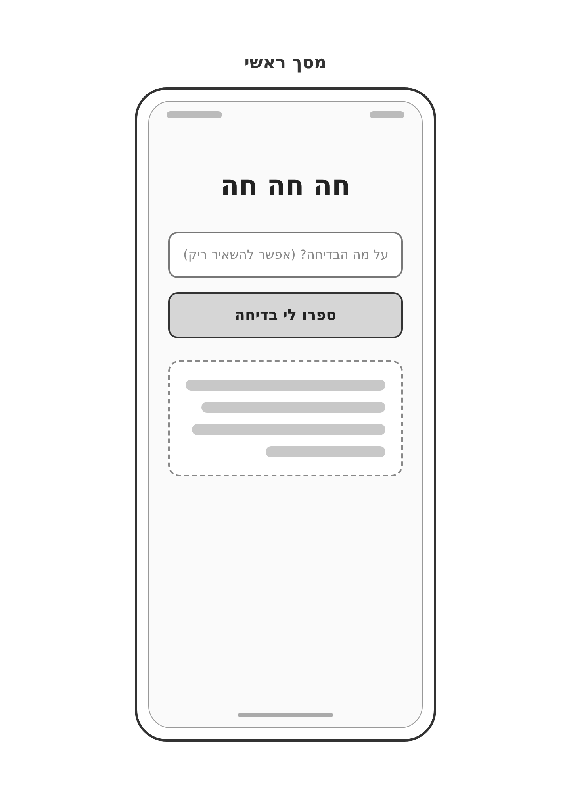
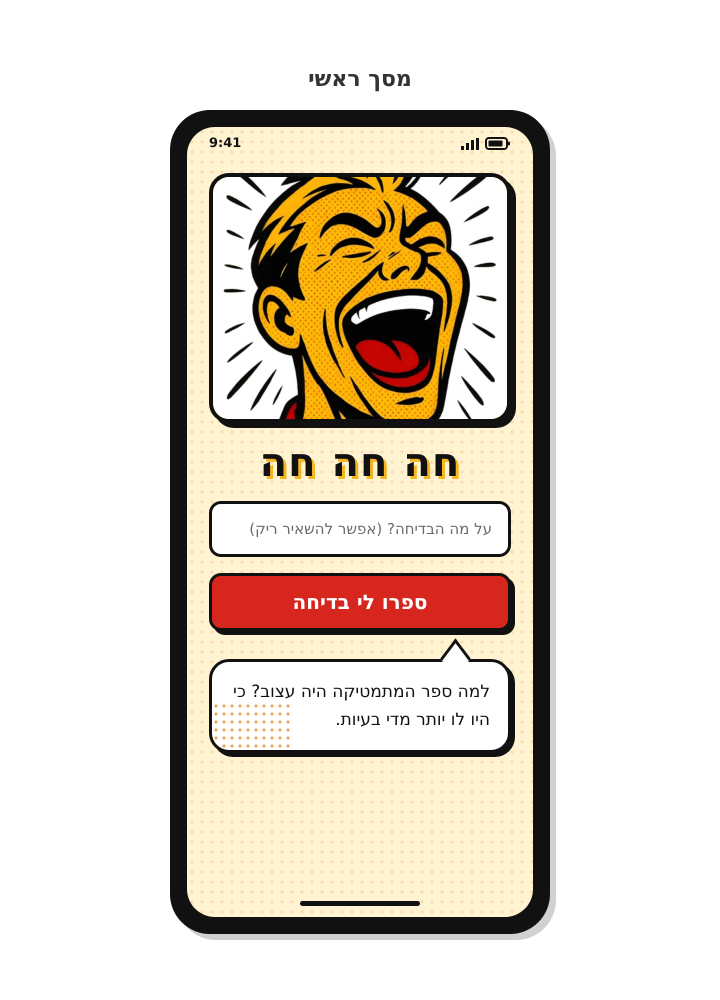
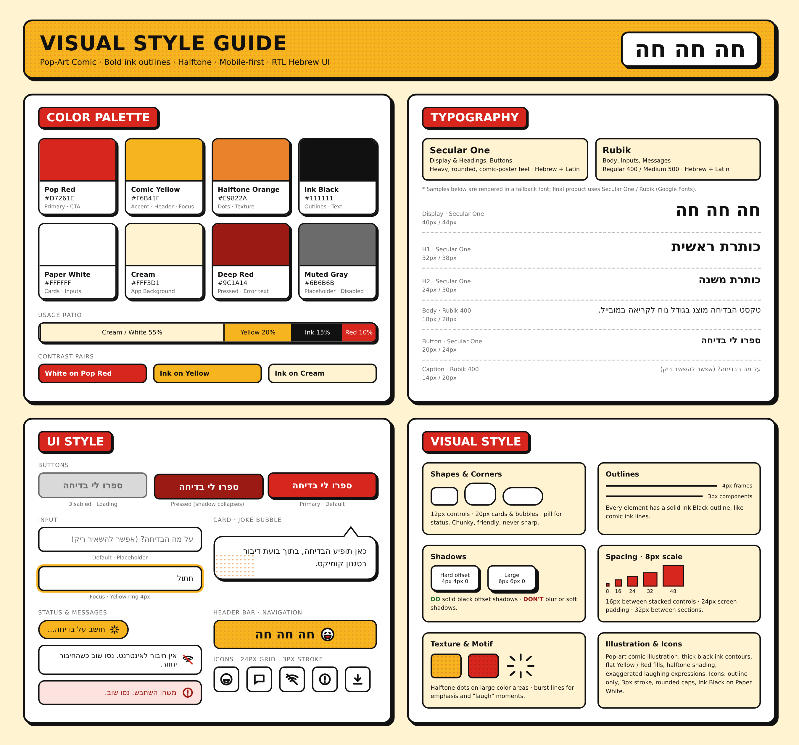

# DESIGN – "חה חה חה"

> מסמך עיצוב לממשק המשתמש, על בסיס PRD.md, ‏wireframes.png, ‏style-guide.png ו-mockups.png.
> דרישות המוצר והתנהגות המסכים מוגדרות ב-PRD ואינן חוזרות כאן. המסמך מתאר את המימוש העיצובי בלבד.

---

## 1. Screens – מסכי האפליקציה

לאפליקציה **מסך אחד בלבד**. מצבי טעינה, שגיאה והצגת בדיחה הם מצבים של אותו מסך, ולא מסכים נפרדים.

### Wireframes

### Mockups

### 1.1 מסך ראשי

**מטרת המסך:**
המשתמש מזין נושא, או משאיר את התיבה ריקה, ומקבל בדיחה בעברית באותו מסך.

**מבנה ותוכן:**
הרכיבים מסודרים בעמודה אחת, מלמעלה למטה, ברוחב מלא בתוך שוליים של 24px.

| # | רכיב | תיאור עיצובי |
|---|---|---|
| 1 | **איור ראשי (Hero)** | האיור בסגנון Pop-Art של אדם צוחק, שסופק כ-Inspiration Board. מוצג במסגרת מלבנית בגובה של כ-250px, עם פינות 20px, קו מתאר 4px ב-Ink Black וצל קשיח 5px. האיור ממלא את המסגרת (Cover) וממוקד בפנים. **הערה:** רכיב זה נוסף ב-Mockups לבקשת בעלת המוצר, ואינו מופיע ב-Wireframes וב-PRD. |
| 2 | **כותרת** | הטקסט "חה חה חה". ממורכז, בסגנון Display (40px/44px), ב-Ink Black עם הצללת טקסט קשיחה של 3px ב-Comic Yellow. |
| 3 | **תיבת טקסט** | Placeholder: "על מה הבדיחה? (אפשר להשאיר ריק)". מעוצבת לפי רכיב ה-Input (סעיף 2.3). |
| 4 | **לחצן** | הטקסט "ספרו לי בדיחה". מעוצב לפי רכיב ה-Primary Button (סעיף 2.3). |
| 5 | **אזור הבדיחה** | כרטיס בצורת בועת דיבור (Joke Bubble), מתחת ללחצן. טקסט הבדיחה מוצג בסגנון Body ומיושר לימין. |

- רקע המסך: Cream ‏(`#FFF3D1`), עם דוגמת נקודות Halftone עדינה בכתום.
- בין רכיבים מוערמים יש מרווח של 16px. מעל בועת הדיבור יש מרווח נוסף כדי לפנות מקום ל"זנב" שלה.
- הטקסט בבועה ב-Mockups הוא טקסט לדוגמה בלבד. בפועל הטקסט מגיע מהשרת.

**מצבי המסך, לפי רכיבי ה-Style Guide:**

| מצב | מימוש עיצובי |
|---|---|
| ברירת מחדל | התיבה ריקה עם Placeholder, הלחצן במצב Primary. בועת הבדיחה מוצגת כבר בפתיחת המסך, ריקה מטקסט. |
| הקלדה | התיבה במצב Focus, עם טבעת צהובה. |
| טעינה | הלחצן במצב Disabled, ומוצג חיווי טעינה בצורת Pill צהוב: "חושב על בדיחה...". החיווי מוצג במקום אזור הבדיחה. |
| הצגת בדיחה | בועת הדיבור עם טקסט הבדיחה, כפי שמופיע ב-Mockups. |
| אין חיבור | הודעת Alert לבנה עם אייקון Wi-Fi מבוטל: "אין חיבור לאינטרנט. נסו שוב כשהחיבור יחזור." |
| שגיאה כללית | הודעת Alert אדומה-בהירה, עם טקסט ואייקון ב-Deep Red: "משהו השתבש. נסו שוב." |
| המודל לא החזיר בדיחה | אותו עיצוב של הודעת השגיאה הכללית (Alert – Error), עם הטקסט: "אופס, משהו התפקשש - נסו שוב". |

הודעות הטעינה והשגיאה מוצגות באותו מיקום שבו מוצגת בועת הבדיחה, ובמקומה.

**פעולות וניווט:**
- הקלדת נושא בתיבה ולחיצה על הלחצן.
- בקשה חדשה מחליפה את התוכן שבאזור הבדיחה.
- אין מעבר למסכים אחרים.

### 1.2 מבנה הניווט הכללי

אין ניווט בין מסכים. האפליקציה היא מסך יחיד ללא תפריטים, טאבים או לחצני חזרה. פתיחה מהדפדפן או מאייקון ה-PWA מובילה ישירות למסך הראשי.

---

## 2. Style Guide – השפה העיצובית

**אווירה כללית:** קומיקס Pop-Art. קווי דיו שחורים ועבים, צבעי צהוב ואדום שטוחים, טקסטורת נקודות Halftone וצללים קשיחים. המראה צריך להיות שובב, נועז וידידותי.

### 2.1 Color Palette

| שם | HEX | שימוש |
|---|---|---|
| Pop Red | `#D7261E` | לחצן ראשי (CTA), תוויות מודגשות |
| Comic Yellow | `#F6B41F` | הדגשות, Header, טבעת Focus, Pill טעינה, הצללת הכותרת |
| Halftone Orange | `#E9822A` | נקודות Halftone וטקסטורה |
| Ink Black | `#111111` | קווי מתאר, טקסט וצללים |
| Paper White | `#FFFFFF` | כרטיסים, שדות קלט, הודעות |
| Cream | `#FFF3D1` | רקע האפליקציה |
| Deep Red | `#9C1A14` | לחצן במצב Pressed, טקסט שגיאה |
| Muted Gray | `#6B6B6B` | Placeholder, טקסט ומסגרת במצב Disabled |
| Light Gray | `#D9D9D9` | רקע לחצן Disabled |
| Error Tint | `#FDE3DF` | רקע הודעת שגיאה כללית |

**יחס שימוש:** בערך 55% Cream או White, 20% Yellow, 15% Ink ו-10% Red.

**צירופים קריאים:** לבן על Pop Red, Ink על Yellow, Ink על Cream.

### 2.2 Typography

| תפקיד | גופן | גודל / גובה שורה |
|---|---|---|
| Display (כותרת האפליקציה) | Secular One | 40px / 44px |
| H1 | Secular One | 32px / 38px |
| H2 | Secular One | 24px / 30px |
| Button | Secular One | 20px / 24px |
| Body (טקסט הבדיחה, שדות, הודעות) | Rubik 400 | 18px / 28px |
| Caption / Placeholder | Rubik 400 | 14px / 20px |

- שני הגופנים זמינים ב-Google Fonts ותומכים בעברית.
- Rubik 500 משמש להדגשה במידת הצורך.
- **הערה:** בתמונות ה-Style Guide וה-Mockups הטקסט מוצג בגופן חלופי. הגופנים המחייבים הם אלה שבטבלה.
- הגופנים נטענים מ-Google Fonts. כשאין חיבור לאינטרנט, הממשק מוצג בגופן מערכת חלופי. זה מקובל.

### 2.3 UI Style

**Primary Button**

| מצב | מראה |
|---|---|
| Default | רקע Pop Red, טקסט לבן ב-Secular One 20px, גובה 58px, פינות 12px, קו מתאר 3px ב-Ink Black וצל קשיח `4px 4px 0 #111111`. |
| Pressed | רקע Deep Red. הלחצן זז 3px ימינה ו-3px למטה, לכיוון הצל, והצל "מתכווץ". |
| Disabled / Loading | רקע Light Gray, טקסט ומסגרת ב-Muted Gray, בלי צל. |

**Input**
- רקע לבן, גובה 56px, פינות 12px וקו מתאר 3px ב-Ink Black.
- טקסט ב-Rubik, מיושר לימין, וה-Placeholder ב-Muted Gray.
- במצב Focus מתווספת טבעת Comic Yellow ברוחב 4px סביב השדה.

**Card – Joke Bubble**
- בועת דיבור לבנה עם פינות 20px, קו מתאר 3px וצל קשיח 4px.
- יש לה "זנב" משולש בצד הימני העליון שמצביע כלפי מעלה, אל הלחצן.
- בפינה השמאלית התחתונה יש קישוט של נקודות Halftone כתומות.
- הטקסט ב-Body, מיושר לימין, עם ריפוד פנימי של כ-16–18px.

**Status & Messages**
- **Loading Pill:** צורת Pill (פינות מלאות), רקע Comic Yellow, קו מתאר 3px ואייקון Burst מימין לטקסט, בתחילת השורה ב-RTL.
- **Alert – Offline:** רקע לבן, פינות 14px, קו מתאר 3px ואייקון Wi-Fi מבוטל עם קו אדום.
- **Alert – Error:** רקע Error Tint, טקסט ואייקון "!" עגול ב-Deep Red.

**Header / Navigation**
- ה-Style Guide מגדיר פס כותרת צהוב עם Halftone, אייקון פרצוף צוחק ושם האפליקציה.
- ב-Mockups הכותרת מוצגת ככותרת Display מתחת לאיור ולא כפס, ולכן **יש לממש לפי ה-Mockups**.
- אין תפריטים במוצר.

**Icons**
- סגנון Outline בלבד, על Grid של 24px.
- קו 3px עם קצוות מעוגלים, ב-Ink Black.
- אייקונים מוגדרים ב-Style Guide: פרצוף צוחק, בועת דיבור, Wi-Fi מבוטל, התראה (!) והורדה.
- במסך עצמו משמשים רק אייקוני ההודעות.

**App Icon – אייקון האפליקציה המותקנת**
- אימוג'י צוחק (😂) ממורכז על רקע Comic Yellow ‏(`#F6B41F`).
- יש להשתמש באימוג'י מספרייה ברישיון פתוח, כמו Noto Emoji של Google, ולא בתמונה של אימוג'י Apple, שאינו חופשי לשימוש.
- גרסת maskable: האימוג'י בתוך "אזור בטוח" של כ-80% מהאייקון, כדי שלא ייחתך במכשירי Android.

### 2.4 Visual Style

- **צורות ופינות:**
  - 12px לרכיבי שליטה (לחצן, שדה).
  - 20px לכרטיסים, לבועות ולמסגרת האיור.
  - Pill מלא לחיוויי סטטוס.
  - אין פינות חדות.
- **קווי מתאר:** לכל רכיב יש קו Ink Black אחיד. 4px למסגרות גדולות, כמו מסגרת האיור, ו-3px לרכיבים.
- **צללים:** צל קשיח בלי טשטוש בלבד, `4px 4px 0` לרכיבים ו-`5px`–`6px` למסגרות גדולות. **אין** צללים רכים.
- **מרווחים:** סולם של 8px (8 / 16 / 24 / 32 / 48).
  - 16px בין רכיבים מוערמים.
  - 24px שוליים צדדיים במסך.
  - 32px בין קבוצות תוכן.
- **Layout:** עמודה אחת, Mobile-first. כל הרכיבים ברוחב מלא של אזור התוכן. הכותרת ממורכזת.
  - במסכים רחבים (מחשב, טאבלט) אזור התוכן מוגבל לרוחב מקסימלי של 480px וממורכז במסך. רקע ה-Cream עם ה-Halftone ממלא את כל רוחב המסך.
- **טקסטורה ומוטיבים:**
  - נקודות Halftone על רקע המסך, בעדינות, ועל משטחי צבע גדולים.
  - קווי "פרץ" (Burst Lines) להדגשת רגעי צחוק.
- **איורים:** איור Pop-Art עם קווי מתאר שחורים ועבים, מילוי שטוח בצהוב ובאדום, הצללת Halftone והבעות צחוק מוגזמות. האיור הקיים הוא ה-Inspiration Board שסופק.
  - קובץ האיור נמצא ב-`spec/image.png`. בזמן הבנייה יש להעתיק אותו לנכסי הפרויקט בשם `public/hero.png`.

### 2.5 שפה וכיווניות

- **שפת הממשק:** עברית בלבד.
- **כיווניות:** RTL ברמת המסמך כולו (`dir="rtl"`, `lang="he"`).
- **יישור:**
  - טקסט רץ, Placeholder והודעות מיושרים לימין.
  - כותרת האפליקציה וטקסט הלחצן ממורכזים.
  - בהודעות עם אייקון, האייקון מופיע מימין לטקסט, בתחילת השורה ב-RTL.
- **מימוש:** יש להשתמש ב-Logical Properties (start / end) ולא ב-left / right. רכיבים כיווניים, כמו זנב הבועה או צל ה-Offset, מוגדרים לפי ה-Mockups.
